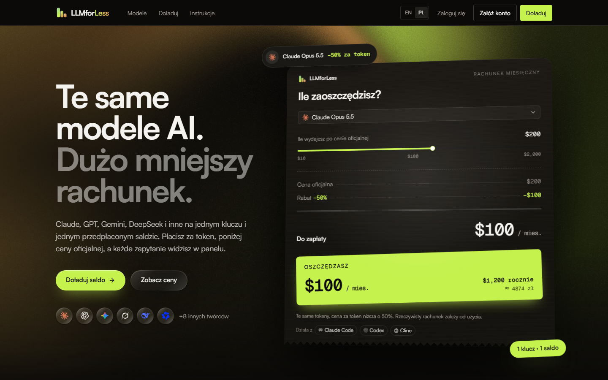
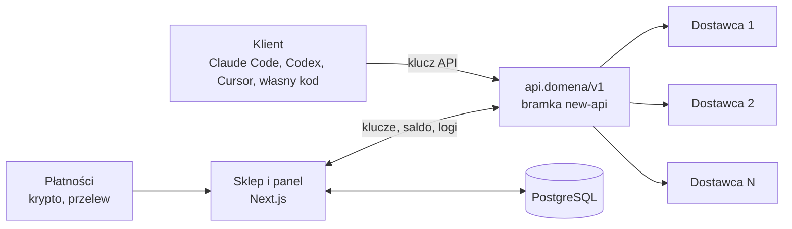
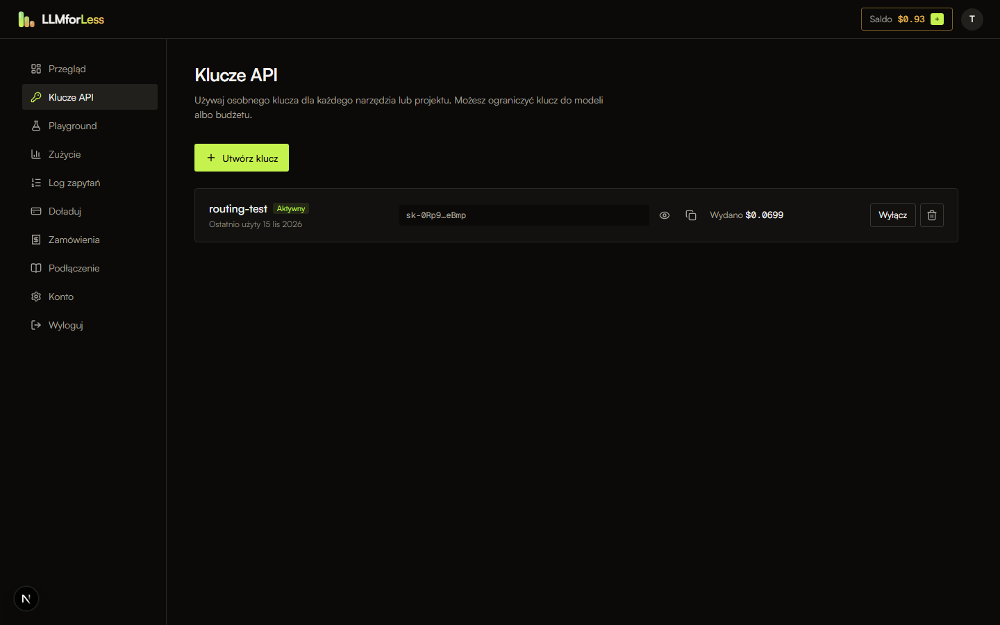
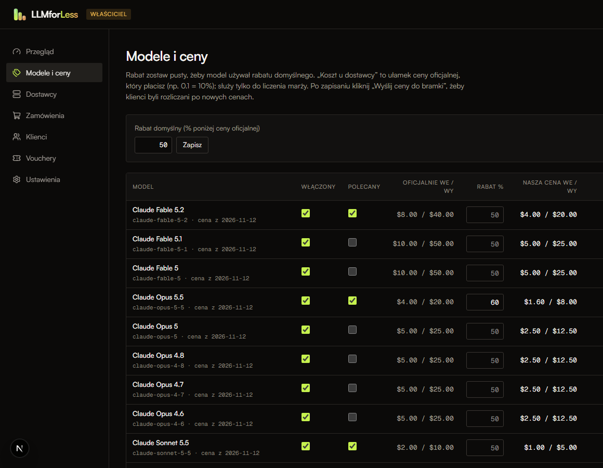

# LLMforLess: jedno API do modeli AI, taniej niż oficjalne cenniki

**Integrator tańszych dostawców API: ok. 12 dostawców i ok. 190 modeli pod jednym kluczem, nawet 80-90% taniej niż oficjalne ceny.**
Next.js · TypeScript · PostgreSQL · Drizzle ORM · new-api · Docker · Caddy · GitHub Actions

> Status: **w trakcie kończenia.** Wersja testowa działa pod [staging.llmforless.com](https://staging.llmforless.com/pl). Ceny na stronie są przykładowe.
> Kod jest w prywatnym repozytorium (produkt komercyjny). Mogę go pokazać na rozmowie.

## Skąd pomysł

Przy moich automatyzacjach (agenci AI, generator stron, outreach) zużywam bardzo dużo tokenów miesięcznie. Zamiast płacić pełne ceny u każdego dostawcy osobno, połączyłem tańszych dostawców API w jedną bramkę z jednym saldem. Najpierw na własny użytek, teraz buduję wokół tego sklep dla innych programistów.

## Co dostaje klient

- **Jeden klucz API do wszystkich modeli**: Claude, GPT, Gemini, Grok, DeepSeek, Qwen, GLM, Kimi, MiniMax, Llama, Seedance i inne.
- **Działa z narzędziami, których ludzie już używają**: Claude Code (natywne Anthropic Messages), Codex (OpenAI Responses), Cursor, Cline i wszystko, co mówi OpenAI Chat Completions.
- **Jedno przedpłacone saldo**, rozliczane za token, z ceną pokazaną obok oficjalnej.
- **Log każdego zapytania**: tokeny, cache, koszt, widoczne w panelu.
- **Instrukcje konfiguracji** krok po kroku dla każdego narzędzia (dla osób, które nigdy nie ustawiały base URL).
- **Faktura VAT** na żądanie, ceny w USD z przeliczeniem na PLN.

| Katalog modeli | Strona zakupu |
|---|---|
|  |  |

## Architektura

- **Sklep i panel**: Next.js (App Router), TypeScript, Drizzle ORM, PostgreSQL, logowanie przez better-auth, dwa języki (PL / EN).
- **Bramka**: self-hosted new-api za sklepem. Klient nigdy nie widzi jej panelu, a sklep zarządza kluczami, saldem i cennikiem przez jej API.
- **Routing i zapasowi dostawcy**: każdy model ma kilka tras z priorytetami. Gdy trasa przestaje działać, bramka przełącza ruch na następną.
- **Testy dostawców**: skrypt sondujący sprawdza każdą trasę (streaming, tool use, cache promptów, ukryte prompty doklejane przez dostawcę, koszt) i na tej podstawie ustalam priorytety tras.
- **Synchronizacja cen**: ceny oficjalne i rabat ustawiany globalnie albo per model, przeliczane automatycznie.
- **Płatności**: kryptowaluty (NOWPayments) i przelew; vouchery na doładowanie.

## Panel klienta i panel administratora

- **Klient**: przegląd salda, klucze API, zużycie i wykresy kosztów, log zapytań, gotowa konfiguracja dla narzędzi, playground do testowania modeli, zamówienia i faktury.
- **Administrator**: klienci, zamówienia, cennik (rabat per model), dostawcy i ich salda, partie voucherów, ustawienia sklepu.

Zrzuty z lokalnej wersji na kontach testowych:

| Klucze API | Zużycie i koszty |
|---|---|
|  |  |

| Gotowa konfiguracja dla Claude Code, Codex, cURL, Python, TypeScript | Panel właściciela: modele i ceny |
|---|---|
|  |  |

| Panel właściciela: zamówienia (przelewy potwierdzane ręcznie, krypto automatycznie) |
|---|
|  |

## Wdrożenie

- Cały system na jednym VPS w Dockerze: sklep, bramka, baza, playground i Caddy z automatycznym HTTPS.
- Osobne adresy: sklep, `api.` dla klientów (tylko ścieżki `/v1/*`), `chat.` dla playgroundu; panel bramki dostępny tylko przez tunel SSH.
- **CI/CD w GitHub Actions**: osobny workflow dla stagingu i produkcji, wdrożenie po SSH z kluczem trzymanym w GitHub Secrets.
- Testy jednostkowe (Vitest) dla katalogu modeli i cennika.

## Wersja mobilna

---

**Autor:** Patryk Olech, AI Automation & GTM Engineer · [inne projekty](https://github.com/patrykolech)
