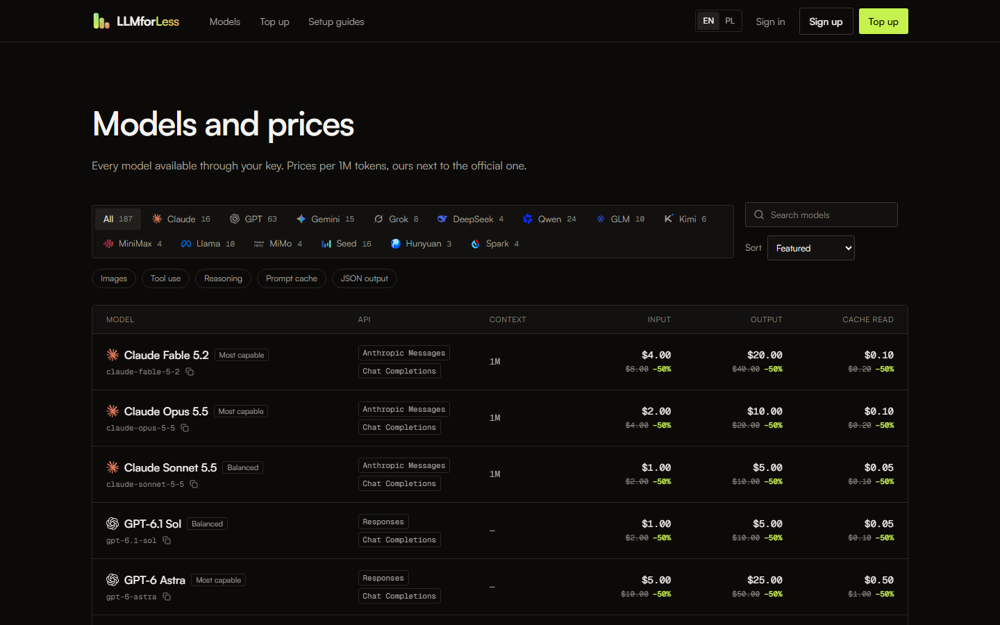
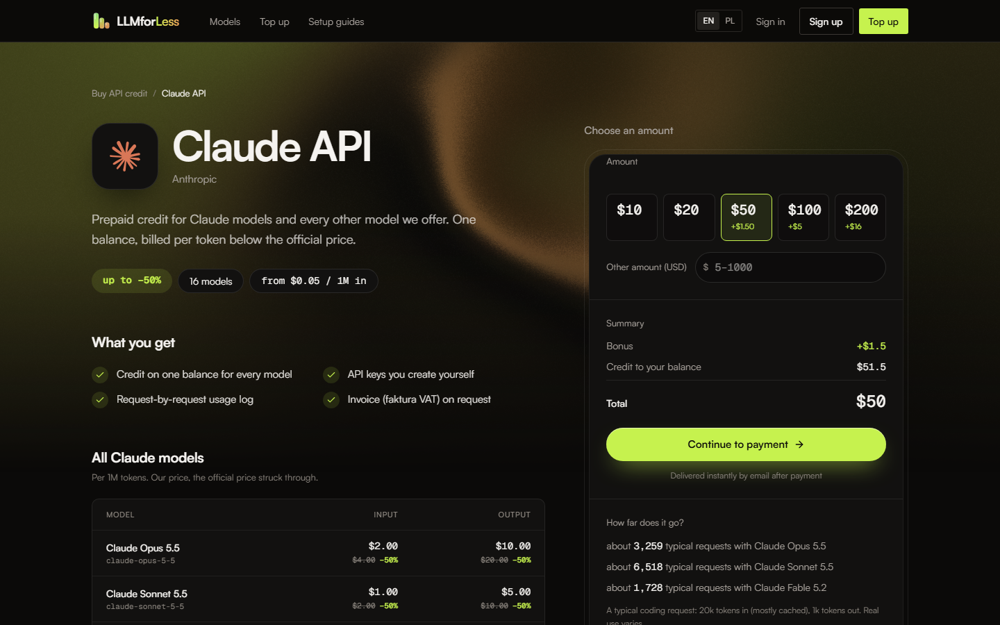
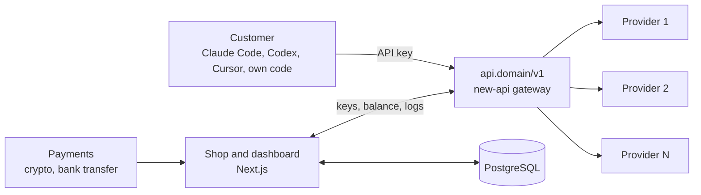
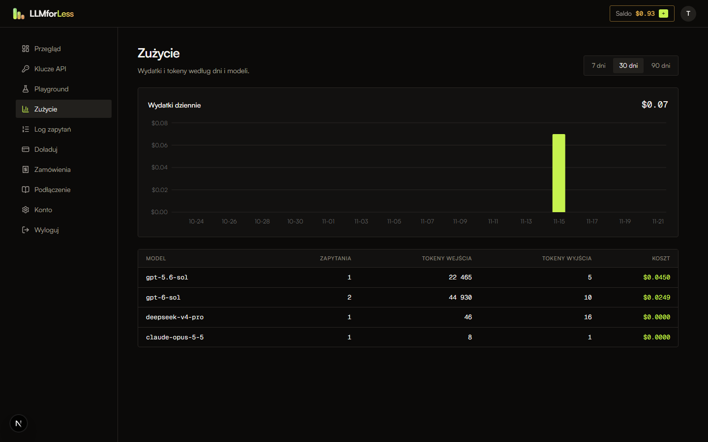
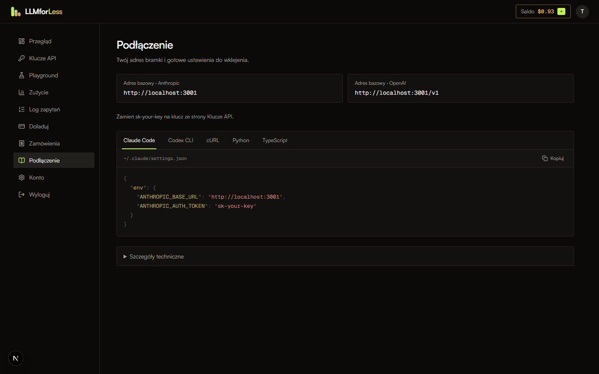
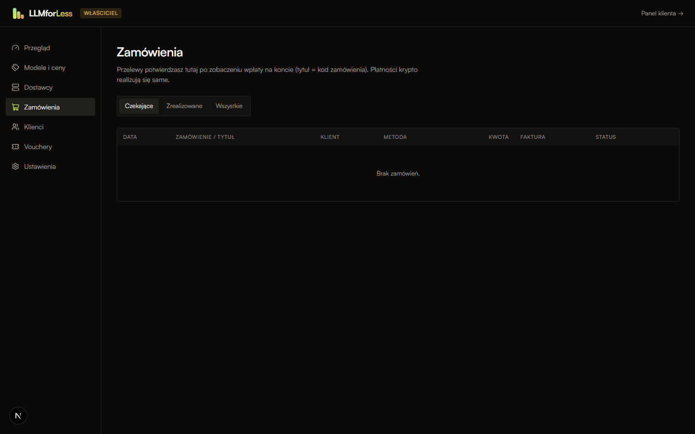
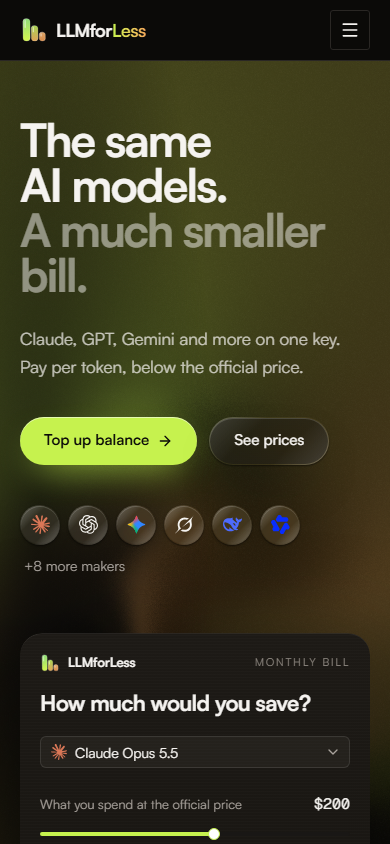

# LLMforLess: one API for AI models, cheaper than list prices

**An aggregator of cheaper API providers: ~12 providers and ~190 models behind one key, up to 80-90% below official prices.**
Next.js · TypeScript · PostgreSQL · Drizzle ORM · new-api · Docker · Caddy · GitHub Actions

> Status: **being finished.** The test version runs at [staging.llmforless.com](https://staging.llmforless.com/en). Prices on the site are placeholders.
> The code is in a private repository (commercial product). I can walk through it in an interview.

## Why I built it

My automations (AI agents, the website generator, outreach) use a lot of tokens every month. Instead of paying full price at each provider separately, I combined cheaper API providers into one gateway with a single balance. First for my own use; now I am building a shop around it for other developers.

## What the customer gets

- **One API key for every model**: Claude, GPT, Gemini, Grok, DeepSeek, Qwen, GLM, Kimi, MiniMax, Llama, Seedance and more.
- **Works with the tools people already use**: Claude Code (native Anthropic Messages), Codex (OpenAI Responses), Cursor, Cline and anything that speaks OpenAI Chat Completions.
- **One prepaid balance**, billed per token, with the price shown next to the official one.
- **A log of every request**: tokens, cache, cost, visible in the dashboard.
- **Step-by-step setup guides** for each tool (for people who have never set a base URL).
- **VAT invoices** on request; prices in USD with a PLN conversion.

| Model catalogue | Purchase page |
|---|---|
|  |  |

## Architecture

- **Shop and dashboard**: Next.js (App Router), TypeScript, Drizzle ORM, PostgreSQL, authentication with better-auth, two languages (EN / PL).
- **Gateway**: self-hosted new-api behind the shop. Customers never see its panel; the shop manages keys, balances and pricing through its API.
- **Routing and fallback providers**: every model has several prioritised routes. When a route stops working, the gateway switches traffic to the next one.
- **Provider tests**: a probing script checks every route (streaming, tool use, prompt caching, hidden prompts injected by the provider, cost), and route priorities are set from the results.
- **Price sync**: official prices and a discount set globally or per model, recalculated automatically.
- **Payments**: cryptocurrencies (NOWPayments) and bank transfer; top-up vouchers.

## Customer dashboard and admin panel

- **Customer**: balance overview, API keys, usage and cost charts, request log, ready-made configuration for tools, a playground for testing models, orders and invoices.
- **Admin**: customers, orders, pricing (discount per model), providers and their balances, voucher batches, shop settings.

Screenshots from the local version on test accounts (dashboard in Polish):

| API keys | Usage and costs |
|---|---|
|  |  |

| Ready-made config for Claude Code, Codex, cURL, Python, TypeScript | Admin panel: models and prices |
|---|---|
|  |  |

| Admin panel: orders (bank transfers confirmed manually, crypto automatically) |
|---|
|  |

## Deployment

- The whole system runs on one VPS in Docker: shop, gateway, database, playground and Caddy with automatic HTTPS.
- Separate hostnames: the shop, `api.` for customers (only `/v1/*` paths), `chat.` for the playground; the gateway panel is reachable only through an SSH tunnel.
- **CI/CD in GitHub Actions**: separate workflows for staging and production, deployment over SSH with the key stored in GitHub Secrets.
- Unit tests (Vitest) for the model catalogue and pricing.

## Mobile version

---

**Author:** Patryk Olech, AI Automation & GTM Engineer · [more projects](https://github.com/patrykolech)
